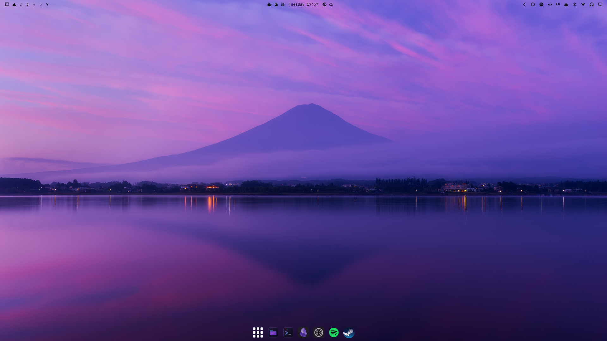
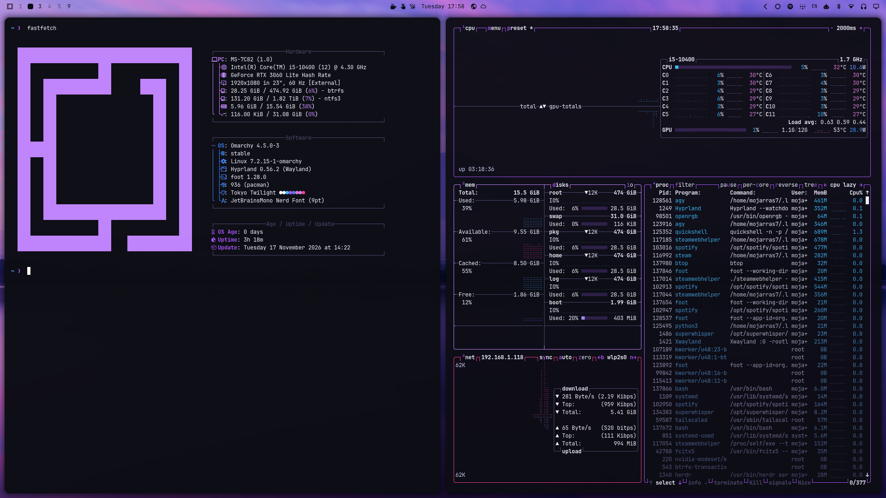

# Tokyo Twilight 🌃

A sleek, macOS-inspired dark theme for [Omarchy Linux](https://omarchy.org/) featuring deep obsidian blacks, Tokyo neon purple, electric cyber blue, and vivid cyber pink accents with clean, borderless rounded window aesthetics.



---

## Highlights

- 🎨 **Tokyo Twilight Palette**: Built on cool macOS twilight slate (`#1a1c26`), vibrant Tokyo neon violet (`#a855f7`), electric cyber blue (`#3b82f6`), cyber pink (`#f43f8e`), and crisp white (`#eef0f8`).
- 🪟 **Borderless & Clean**: Zero window borders and smooth 12px macOS-style rounded corners for a clean, distraction-free desktop.
- ⚡ **Minimalist Terminal**: Refined ANSI color palette strictly tuned to purples, blues, whites, and pinks.
- 🚀 **Zero-Border Menus**: Translucent, blurred quick-menu (<kbd>Super</kbd> + <kbd>Space</kbd>) and popups with 0 borders.
- 🖼️ **4K / 5K / 6K Wallpaper Collection**: 5 ultra-high-resolution cinematic landscapes optimized for high-DPI displays.

---

## Screenshots

### Desktop View


### Terminal & Menu


---

## Quick Install

You can install and apply **Tokyo Twilight** directly with the Omarchy CLI:

```bash
omarchy theme install https://github.com/Mojarras7/omarchy-tokyo-twilight-theme.git
```

Or if you prefer to clone it manually into your themes directory:

```bash
git clone https://github.com/Mojarras7/omarchy-tokyo-twilight-theme.git ~/.config/omarchy/themes/tokyo-twilight
omarchy theme set tokyo-twilight
```

To switch wallpapers at any time:
```bash
omarchy theme bg next
```
*(Or press <kbd>SUPER</kbd> + <kbd>CTRL</kbd> + <kbd>W</kbd>)*

---

## Recommended Look & Feel (Hyprland)

For the full clean macOS aesthetic (12px rounded corners, no window borders), add or verify the following in your `~/.config/hypr/looknfeel.lua`:

```lua
hl.config({
  general = {
    border_size = 0,
    gaps_in = 6,
    gaps_out = 10,
  },

  decoration = {
    rounding = 12,
    rounding_power = 2,
    shadow = {
      enabled = true,
      range = 24,
      render_power = 3,
      color = "rgba(00000077)",
    },
    blur = {
      enabled = true,
      size = 6,
      passes = 2,
    },
  },
})

-- Explicitly ensure terminal windows remain borderless
o.window({ tag = "terminal" }, { border_size = 0 })
```

Then reload Hyprland:
```bash
hyprctl reload
```

---

## Color Palette

| Swatch | Color Name | Hex Code | Purpose |
|:---:|:---|:---:|:---|
| ⬛ | **Twilight Slate** | `#1a1c26` | Background / Terminal surface |
| 🟪 | **Tokyo Purple** | `#a855f7` | Primary Accent / Menu focus / Active indicators |
| 🟦 | **Cyber Blue** | `#3b82f6` | Secondary Accent / Highlights |
| 🩵 | **Ice Blue** | `#38bdf8` | Terminal Cyan / Links |
| 🌸 | **Neon Pink** | `#f43f8e` | Terminal Red / Alerts / Status |
| 🌺 | **Pastel Pink** | `#f472b6` | Terminal Yellow / Warm accents |
| 🪻 | **Lilac Lavender** | `#c084fc` | Terminal Green / Soft violet |
| ⬜ | **Clean White** | `#eef0f8` | Foreground Text |

---

## Wallpapers Included

| File | Resolution | Description |
|:---|:---:|:---|
| `1-fuji-twilight-5k.jpg` | 5120 × 2880 (5K) | Mount Fuji reflection over calm lake at dusk with purple twilight clouds |
| `2-tokyo-skyline-4k.jpg` | 3840 × 2160 (4K) | Rooftop view overlooking Tokyo twilight with glowing Tokyo Tower |
| `3-rainbow-bridge-5k.jpg` | 5120 × 2160 (5K) | Illuminated Rainbow Bridge and Tokyo Bay at dusk |
| `4-tokyo-tower-stars-4k.jpg` | 3840 × 2160 (4K) | Tokyo Tower beneath a starry twilight sky and Milky Way |
| `5-fuji-starry-lake-6k.jpg` | 6144 × 3456 (6K) | Mount Fuji starry night reflection over Lake Yamanaka |

---

## Companion Projects

- 🎮 **[Omarchy Game Mode](https://github.com/Mojarras7/omarchy-game-mode)**: Console-style immersive gaming space on Hyprland's `special:gaming` workspace with an Omarchy bar widget and instant `Super + G` switching.
- ⌨️ **[Omarchy Keys](https://github.com/Mojarras7/omarchy-keys)**: Native Qt6 app for managing Omarchy Hyprland keybindings with smart bind/unbind recommendations.

---

## Author

Created by **Alejandro Mojarras** ([@Mojarras7](https://github.com/Mojarras7)).

Designed with ❤️ for the [Omarchy](https://omarchy.org/) community.

## License

[MIT License](LICENSE) © 2026 Alejandro Mojarras
